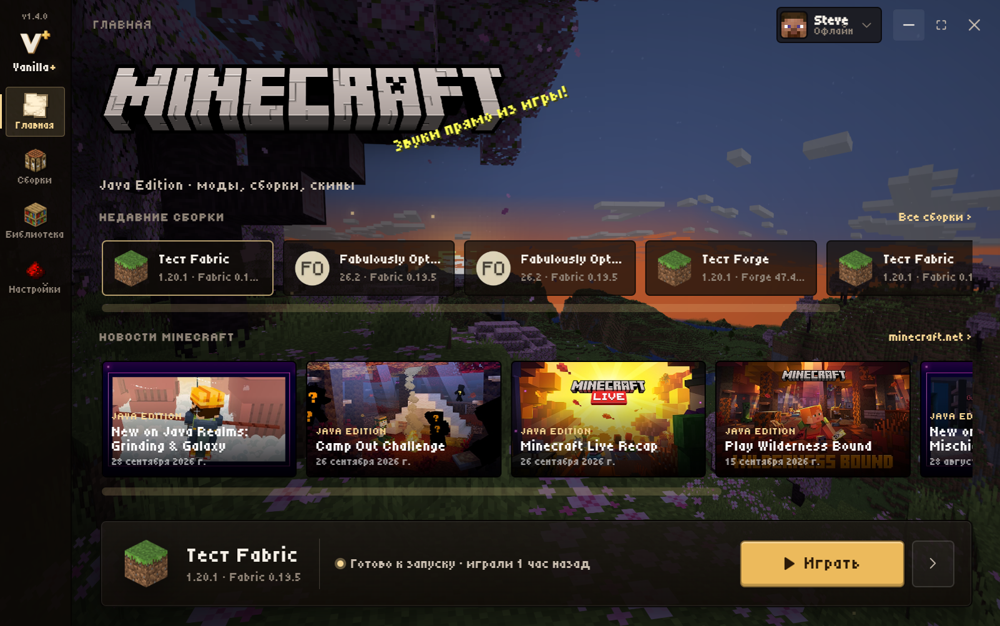
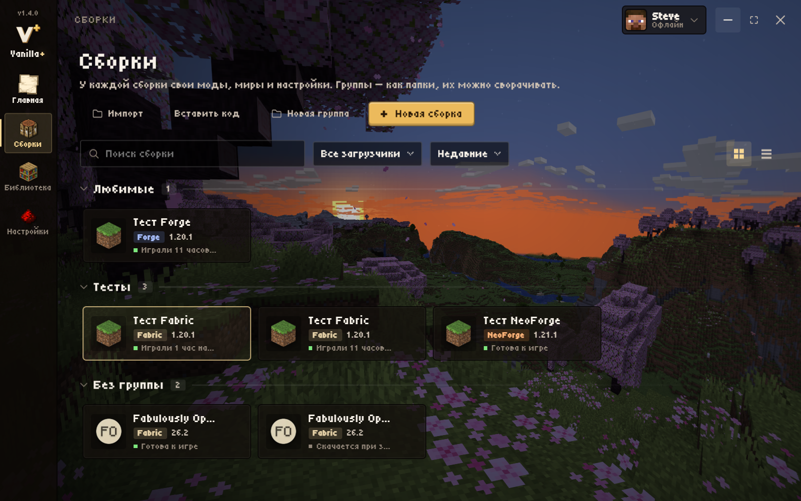
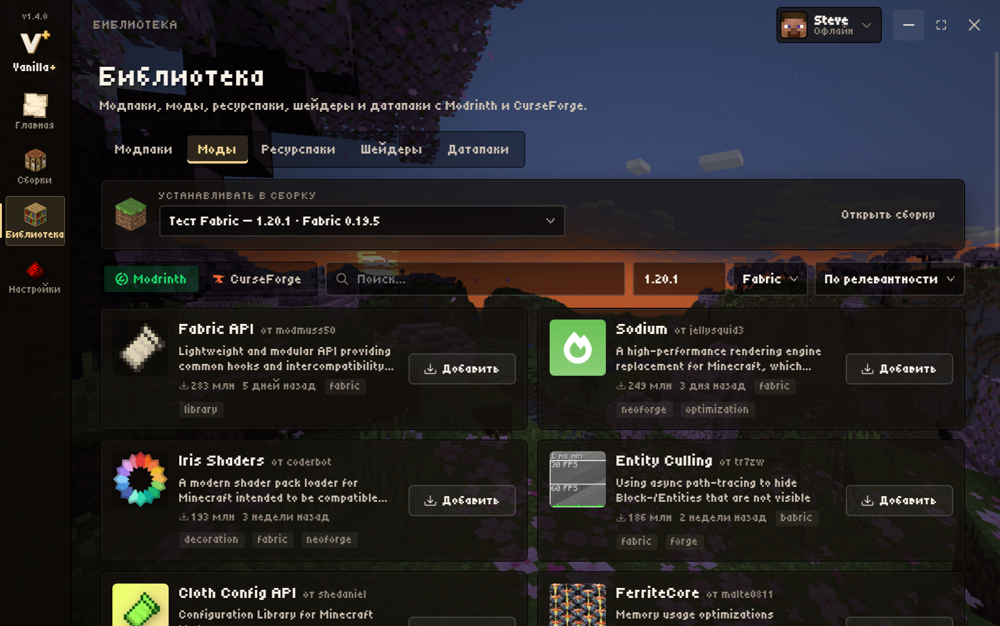
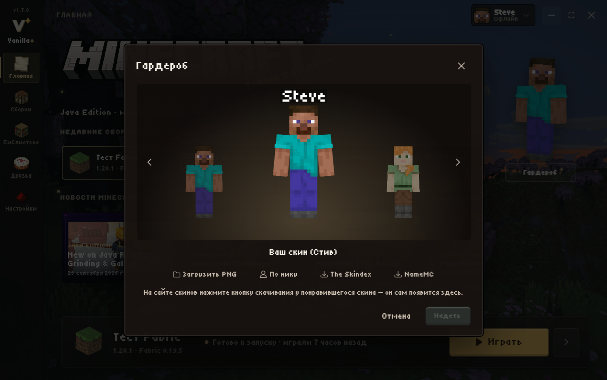
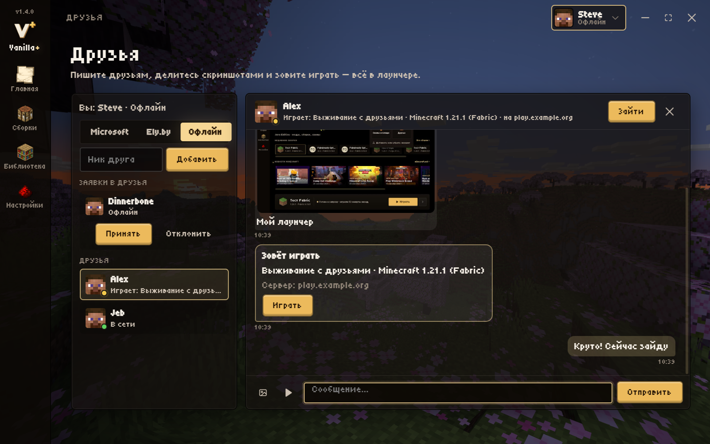

# Amethyx Launcher

Лаунчер Minecraft: Java Edition для Windows с открытым исходным кодом.

[English](README.md) · **Русский**

**Скачать:** [последний релиз](https://github.com/VanillaPlusLauncher/VanillaPlus/releases/latest) → `Amethyx-Setup-<версия>.exe`.
Установленный лаунчер обновляется сам: новая версия скачивается в фоне, установка — одной кнопкой.



## Возможности

- **Аккаунты:** офлайн, Microsoft, [Ely.by](https://ely.by) (скины через authlib-injector)
- **Библиотека:** модпаки, моды, ресурспаки, шейдеры и датапаки с Modrinth и CurseForge; зависимости ставятся сами, обновления модов (в том числе автоматически перед запуском), отметки «клиент / сервер» и выключение клиентских модов для сервера
- **Перенос из других лаунчеров:** Prism, ElyPrism, PolyMC, MultiMC, Modrinth App, CurseForge, ATLauncher, GDLauncher, Millida, TLauncher, SKLauncher, Legacy Launcher, официальный лаунчер — сборки находятся сами
- **Сборки как в Prism Launcher:** вкладки модов, ресурспаков, шейдеров, миров, своего сервера, скриншотов и журнала; смена версии игры и загрузчика, свои настройки Java и памяти, заметки, свои группы с перетаскиванием
- **Журнал игры** объясняет частые ошибки, после вылета сразу показывает причину
- **Гардероб:** готовые скины из PNG, по нику или с The Skindex и NameMC (скачанный там скин сам появляется в лаунчере), 3D-просмотр с анимациями; свой скин у каждого аккаунта, скин Amethyx для Microsoft и Ely.by (настоящий скин не меняется)
- **Друзья:** заявки, кто в сети и во что играет, чат, вход к другу в мир через мод e4mc (без белого IP) или на сервер одной кнопкой
- Оформление в стиле Minecraft: панорамы из разных версий игры, звуки (свой для каждого действия) и музыка
- Семь языков: русский, английский, испанский, португальский, немецкий, французский, китайский
- Сам замечает новые версии Minecraft и обновляется сам
- Работает на 64-битной Windows 10 (с версии 1803) и Windows 11

### Новое в 1.7.0 (готовится к выходу)

- **Друзья и чат:** кто в сети и во что играет, сообщения, скриншоты из игры, приглашения со сборкой, которую друг собирает одной кнопкой
- **Друг заходит в ваш мир** без белого IP: откройте мир для сети, лаунчер сам ставит мод e4mc и отправляет другу адрес
- **3D-игрок на главной:** смотрит на мышку, здоровается и делает жесты; под ним **Гардероб** как в Bedrock
- **Готовые скины:** из PNG, по нику, с The Skindex и NameMC — скачанный на сайте скин сам появляется в Гардеробе; **скин Amethyx** для Microsoft и Ely.by видят другие игроки Amethyx
- **Перенос из других лаунчеров:** Prism, ElyPrism, MultiMC, Modrinth App, CurseForge, TLauncher и другие — сборки находятся сами
- **Оптимизация в один клик:** моды для скорости, память, флаги Java и графика под ваш компьютер; не советует моды, несовместимые со сборкой
- **Модпаки ставятся быстрее:** 12 загрузок сразу и общий кэш модов
- **Свой сервер в один клик**, **экспорт сборки** кодом или файлом (.mrpack, CurseForge .zip, .zip), **копии миров**, **проверка совместимости** модов
- **Трей:** крестик прячет лаунчер к часам; **свои уведомления** со значком Amethyx
- **Панорамы** из 19 версий Minecraft, **семь языков**, **звук для каждого действия**, вход в **Ely.by через сайт**
- Новое имя, логотип-пиксельная X и аметистовый стиль; данные Vanilla+ Launcher и RichLauncher переносятся сами

| Сборки | Библиотека | Гардероб | Друзья |
| --- | --- | --- | --- |
|  |  |  |  |

## Сборка из исходников

Нужны Windows 10/11, [Node.js](https://nodejs.org) (для `npm install`), [Python 3](https://www.python.org) и [Inno Setup 6](https://jrsoftware.org/isinfo.php).

```powershell
cd src
npm install --omit=dev
cd ..
.\installer\build.ps1
```

`build.ps1` при первом запуске скачивает Electron (с проверкой SHA-256), упаковывает `src` в `app.asar` и собирает установщик в `build\`.
Для запуска без установщика: `build\Amethyx\Amethyx.exe` после того же скрипта.

Выпуск новой версии: поднять `version` в `src/package.json`, собрать, затем
`.\installer\publish-update.ps1 -Repo VanillaPlusLauncher/VanillaPlus -Notes "Что нового" -Publish`.

## Устройство

- `src/src/main` — главный процесс Electron: аккаунты, установка версий и загрузчиков, запуск игры, моды, Java, обновления
- `src/src/renderer` — интерфейс (без фреймворков, ES-модули)
- `src/src/preload` — мост между ними: всё общение идёт через IPC с проверкой входных данных
- `installer` — установщик (Inno Setup), сборка и публикация
- `server` — сервер Amethyx для друзей, чата и общих скинов (Cloudflare Workers + D1), как его запустить — в [server/README.md](server/README.md)

## Лицензия

[GPL-3.0](LICENSE). Сторонние компоненты и их лицензии — в [THIRD_PARTY.md](THIRD_PARTY.md).

Amethyx Launcher — неофициальный лаунчер. Он не связан с Mojang Studios или Microsoft и не одобрен ими. Minecraft — товарный знак Mojang Studios.
